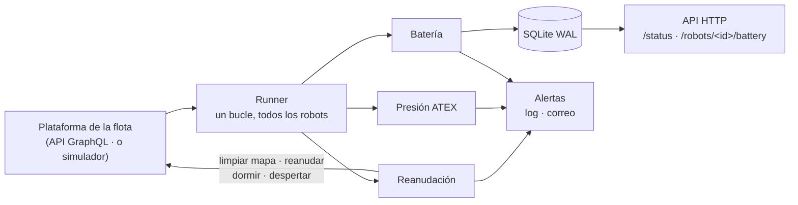
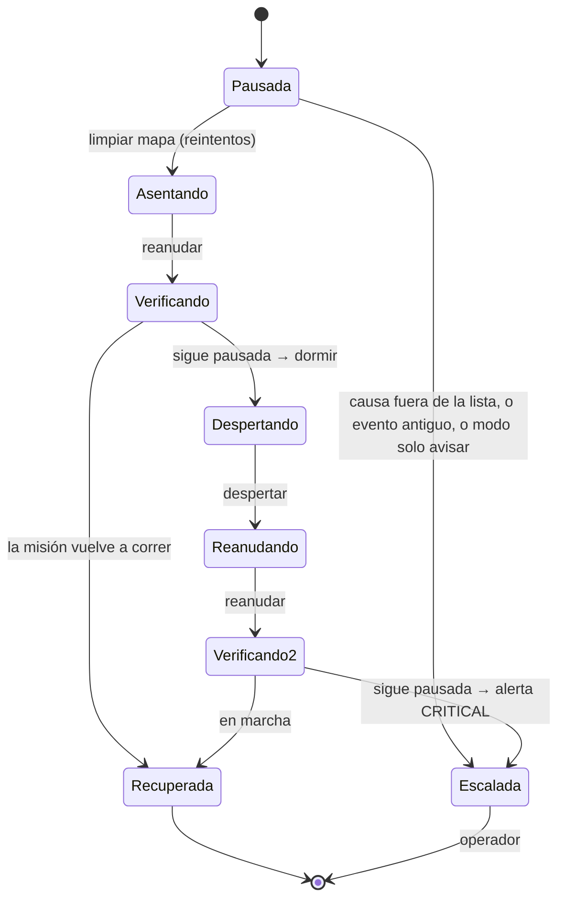

# Robot Fleet Watchdogs

[](https://github.com/aseinotegi/robot-fleet-watchdogs-showcase/actions/workflows/ci.yml)


[English](README.md) · **Español**

Los robots autónomos de inspección se paran muchas veces al día por motivos triviales (un obstáculo temporal, un docking fallido, una pérdida de navegación) y cada parada esperaba a que alguien se diera cuenta. Mientras, valores críticos como la presión de una carcasa ATEX, o una batería que se agota a las 3 de la mañana, no los vigilaba nadie.

Estos watchdogs supervisan toda la flota 24/7 y **actúan solos cuando es seguro**, y solo entonces:

| Watchdog | Qué hace |
|---|---|
| **Reanudación automática** | Recupera misiones pausadas: limpiar mapa de obstáculos → reanudar → verificar, con alternativa de dormir/despertar. Solo para causas en lista blanca y eventos recientes; el resto, a un operador. |
| **Presión ATEX** | Avisa de cambios de presión *confirmados* (N lecturas seguidas), nunca de una lectura suelta. El estado persiste entre reinicios: nada se avisa dos veces. |
| **Batería** | Guarda el histórico en SQLite (WAL) y avisa de nivel bajo/crítico con histéresis; sin alerta si el robot ya está cargando. |

Es una reimplementación limpia e independiente del fabricante de los watchdogs que tengo en producción para una flota de robots de inspección en plantas de oil & gas.



## Prueba rápida: una flota rebelde con un comando

```bash
docker compose up --build
```

Tres robots simulados empiezan sus rondas y se paran de vez en cuando: obstáculos, docking agotado, fallos de navegación, paradas de emergencia. Las baterías se gastan y se cargan, y la presión ATEX tiene lecturas erróneas y caídas reales. Mira cómo lo resuelven los watchdogs:

- **Correos de alerta:** http://localhost:8025 (buzón Mailpit)
- **Estado en vivo:** http://localhost:8080/status
- **Histórico de batería:** http://localhost:8080/robots/inspector-01/battery?hours=1

```text
INFO   ALERT [INFO] Inspector 02: Mission 'Daily gauge round' resumed automatically — Recovered in 10 s. Steps: clear obstacle map → resume
ERROR  ALERT [CRITICAL] Inspector 01: ATEX pressure LOW — Confirmed after 2 readings (raw: PRESSURE_LOW)
INFO   ALERT [INFO] Inspector 01: ATEX pressure back to nominal — Raw: PRESSURE_NOMINAL
```

Sin Docker: `pip install -e ".[dev]"` y `fleet-watchdogs -c config/example.yaml`.

## Cómo decide la reanudación



- **Recuperar con criterio, no a ciegas:** solo causas de una lista blanca configurable, y solo si el evento es reciente (`max_event_age_s`). Una pausa antigua significa que las condiciones pueden haber cambiado.
- **Primero avisa, después actúa:** con `mode: notify` informa de lo que *haría* sin tocar ningún robot. Así se arranca en una planta nueva; `mode: act` llega cuando operación confía en él.
- **Sin bucles:** dos estrategias y, si fallan, una única alerta CRITICAL. Tampoco pelea con un operador: si alguien reanuda la misión a mitad de la recuperación, el watchdog se retira.
- **Nada se bloquea:** cada robot tiene una pequeña máquina de estados que avanza en cada ciclo. Un solo bucle supervisa toda la flota y un robot lento no retrasa a los demás.

## Conectar una plataforma real

`GraphQLPlatform` gestiona el login, guarda el token, lo renueva antes de que caduque y reintenta una vez si la API responde `401` o `UNAUTHENTICATED`. Las consultas de `src/fleet_watchdogs/queries/` siguen un esquema genérico; adáptalas (y las líneas de lectura de la respuesta) a tu fabricante. Watchdogs, alertas y almacenamiento no cambian.

```yaml
platform:
  type: graphql
  graphql_url: https://robots.example.com/graphql
  login_url: https://robots.example.com/api/login
robots:
  - { id: "robot-a", name: "Inspector A" }
```

Las credenciales solo llegan por entorno (`PLATFORM_USERNAME`, `PLATFORM_API_KEY`, `SMTP_USERNAME`, `SMTP_PASSWORD`). Si se escribe una clave o contraseña en el YAML, no arranca.

## Decisiones de diseño

- **Una interfaz, muchas plataformas.** Los watchdogs dependen de un protocolo `RobotPlatform` pequeño, no del SDK de un fabricante. El simulador y el adaptador GraphQL son intercambiables, y eso es también lo que permite probar la lógica sin un robot.
- **Los fallos se quedan donde ocurren.** Una excepción de un robot o de un watchdog se cuenta y se registra; el resto de la flota sigue vigilada. Un servidor de correo caído no silencia el log.
- **Alertas con intención.** Cada alerta tiene severidad. Las recuperaciones rutinarias son `INFO` y se quedan en el log; el correo se reserva para lo que necesita a una persona (`min_severity`).
- **Estado duradero donde importa.** El estado ATEX se escribe de forma atómica (escribir y renombrar), así que un reinicio ni olvida ni repite una alerta. El histórico de batería vive en SQLite en modo WAL: la API lee mientras el watchdog escribe, con retención automática.

## Estructura

```text
src/fleet_watchdogs/
  platform.py          interfaz independiente del fabricante (misiones, batería, ATEX, acciones)
  graphql_platform.py  adaptador GraphQL: login con token, renovación, reintentos
  simulator.py         flota rebelde para demos y tests
  auto_resume.py       máquina de estados de recuperación
  atex.py              cambios de estado confirmados + persistencia
  battery.py           histórico SQLite + alertas con histéresis
  notify.py            canales log y SMTP
  runner.py            bucle de supervisión con fallos aislados
  api.py               API HTTP de solo lectura (librería estándar)
tests/                 46 tests, incluidas dos horas simuladas de operación de la flota
```

## Tests

```bash
pytest -q
ruff check .
```

Cubren todos los caminos de recuperación (reintentos, alternativa, escalado, operador que toma el control), filtrado de lecturas erróneas, persistencia entre reinicios, histéresis, renovación de token, aislamiento de fallos y dos horas simuladas de toda la flota. La CI los ejecuta en Python 3.10–3.13 y construye la imagen Docker.

---

**Ander Sein** · Ingeniero IIoT y de automatización industrial · [andersein.com](https://andersein.com) · [LinkedIn](https://www.linkedin.com/in/ander-sein-a24097195/)

Licencia MIT
