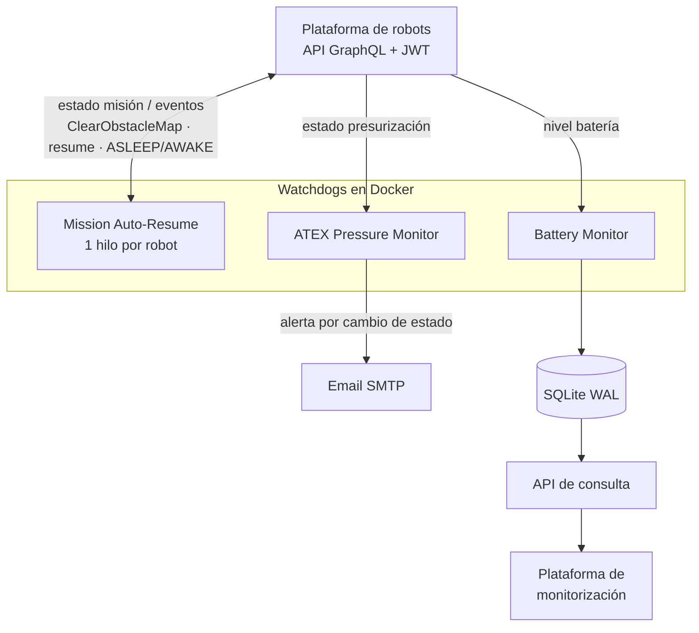

# 🛡️ Robot Fleet Watchdogs — Servicios de vigilancia autónoma para flotas de robots

Conjunto de **microservicios en producción** que vigilan 24/7 una flota de robots de inspección en instalaciones oil & gas y **actúan solos** ante los fallos más habituales, sin que un operador tenga que intervenir.

> **Nota:** este repositorio es un **caso de estudio anonimizado**. Describe un sistema real que he diseñado y que está en producción para un cliente industrial. No contiene código ni datos porque son confidenciales; el objetivo es mostrar la arquitectura, las decisiones técnicas y cómo trabajo con estas tecnologías.

## 🎯 El problema

Un robot autónomo en planta se detiene por motivos triviales muchas veces al día: un obstáculo temporal, un docking fallido, una pérdida de navegación. Cada parada requería que alguien la viera y reanudara la misión a mano. Además, hay variables críticas (presión de la carcasa ATEX, batería) que nadie mira a las 3 de la mañana.

## 💡 La solución

Tres watchdogs independientes, dockerizados, que hablan con la API GraphQL de la plataforma de robots:

### 🔄 Mission Auto-Resume
- Monitoriza N robots en paralelo (un hilo por robot).
- Detecta misiones en `PAUSED` y comprueba que el **último evento es "recuperable"** y reciente (lista configurable: fallo de navegación, docking excedido…).
- Secuencia de recuperación: `ClearObstacleMap` (con reintentos) → espera → `resumeMission`. Si falla, **fallback** `ASLEEP → AWAKE → resume`.
- Renovación automática del token sin cortar la monitorización. Parada segura con Ctrl+C.

### 🧯 ATEX Pressure Monitor
- Vigila la presurización de la carcasa ATEX del robot (estados `NOMINAL / LOW / CRITICALLY_LOW`).
- **Deduplicación de alertas**: avisa al cambiar de estado estable, no en cada lectura.
- Notificación por correo (SMTP/SSL) con credenciales externalizadas en variables de entorno. Tests unitarios.

### 🔋 Battery Monitor
- Registra el estado de batería de cada robot en SQLite (modo WAL + timeout para evitar bloqueos) y lo expone por API.
- Cliente GraphQL recreado al refrescar el token (evita sesiones zombis).

## 🧰 Stack

| Capa | Tecnologías |
|---|---|
| Lenguaje | Python 3 · threading · `gql` (GraphQL) · PyYAML · requests |
| Datos | SQLite (WAL) · API ligera para consulta |
| Notificaciones | SMTP / EmailMessage |
| Infra | Docker · scripts de actualización · configuración por YAML + `.env` |
| Calidad | tests unitarios · logs por robot |

## ⚙️ Aspectos de ingeniería destacados

- 🧠 **Recuperación segura, no ciega**: solo se reanuda si la causa está en una lista blanca y el evento tiene menos de X segundos.
- 🧱 **Un servicio, una responsabilidad**: cada watchdog se despliega, actualiza y reinicia por separado.
- 🔐 **Cero secretos en código**: todo por entorno, con validación de variables obligatorias al arrancar.

## 🔬 Cómo trabajo con estas tecnologías

- **Empezar por el fallo real**: cada watchdog nace de un tipo de incidencia concreto medido en planta (paradas por obstáculo, avisos ATEX perdidos, baterías agotadas de noche), no de una lista de features.
- **Configuración por YAML + entorno**: robots, intervalos, listas blancas y credenciales fuera del código; el mismo contenedor sirve para cualquier planta.
- **Probar sin robot**: tests unitarios con respuestas GraphQL simuladas para validar la lógica de decisión antes de tocar un robot real.
- **Desplegar poco a poco**: primero en modo "solo avisa", después en modo "actúa", robot a robot.

## 👤 Mi rol

Diseño, desarrollo, despliegue y operación de los tres servicios en planta.

## 📬 Contacto

Ander Sein · [LinkedIn](https://www.linkedin.com/in/ander-sein-a24097195/) · aseinotegi@gmail.com
