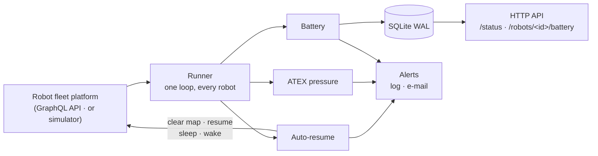
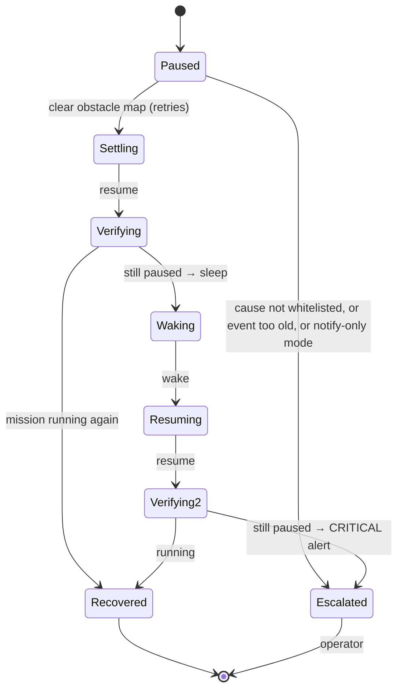

# Robot Fleet Watchdogs

[](https://github.com/aseinotegi/robot-fleet-watchdogs/actions/workflows/ci.yml)


**English** · [Español](README.es.md)

Autonomous inspection robots in industrial plants stop many times a day for trivial reasons (a temporary obstacle, a failed docking, lost navigation) and each stop used to wait for someone to notice it. Meanwhile, safety-critical values such as the pressure of an ATEX enclosure, or a battery running out at 3 a.m., had nobody watching them.

These watchdogs supervise a whole fleet 24/7 and **act on their own when it is safe**, and only then:

| Watchdog | What it does |
|---|---|
| **Auto-resume** | Recovers paused missions: clear obstacle map → resume → verify, with a sleep/wake fallback. Only for whitelisted causes and recent events; everything else goes to an operator. |
| **ATEX pressure** | Alerts on *confirmed* pressure changes (N consecutive readings), never on a single glitch. State persists across restarts, so nothing is reported twice. |
| **Battery** | Keeps a history in SQLite (WAL) and alerts on low/critical levels with hysteresis; no alert while the robot is already charging. |

It is a clean, vendor-neutral reimplementation of watchdogs I run in production for a fleet of inspection robots in oil & gas plants.



## Quick start: a misbehaving fleet in one command

```bash
docker compose up --build
```

Three simulated robots start their rounds and pause now and then: obstacles, docking timeouts, navigation failures, emergency stops. Their batteries drain and charge, and ATEX pressure glitches and drops. Watch the watchdogs deal with it:

- **Alert e-mails:** http://localhost:8025 (Mailpit inbox)
- **Live state:** http://localhost:8080/status
- **Battery history:** http://localhost:8080/robots/inspector-01/battery?hours=1

```text
INFO   ALERT [INFO] Inspector 02: Mission 'Daily gauge round' resumed automatically — Recovered in 10 s. Steps: clear obstacle map → resume
ERROR  ALERT [CRITICAL] Inspector 01: ATEX pressure LOW — Confirmed after 2 readings (raw: PRESSURE_LOW)
INFO   ALERT [INFO] Inspector 01: ATEX pressure back to nominal — Raw: PRESSURE_NOMINAL
```

Without Docker: `pip install -e ".[dev]"` and `fleet-watchdogs -c config/example.yaml`.

## How auto-resume decides



- **Recover safely, not blindly:** only causes on a configurable whitelist, and only if the event is recent (`max_event_age_s`). An old pause means conditions may have changed.
- **First notify, then act:** `mode: notify` reports what it *would* do without touching any robot. That is how a new site starts; `mode: act` comes once operations trust it.
- **No loops:** two strategies, then a single CRITICAL alert. It never fights an operator either: if someone resumes the mission mid-recovery, the watchdog steps back.
- **Nothing blocks:** each robot has a small state machine advanced on every cycle. One loop supervises the whole fleet, and a slow robot never delays the others.

## Connecting a real platform

`GraphQLPlatform` handles login, token caching, refresh before expiry and a single retry when the API answers `401` or `UNAUTHENTICATED`. The queries in `src/fleet_watchdogs/queries/` follow a generic schema; adapt them and the `_parse` lines to your vendor. The watchdogs, alerts and storage stay the same.

```yaml
platform:
  type: graphql
  graphql_url: https://robots.example.com/graphql
  login_url: https://robots.example.com/api/login
robots:
  - { id: "robot-a", name: "Inspector A" }
```

Credentials only come from the environment (`PLATFORM_USERNAME`, `PLATFORM_API_KEY`, `SMTP_USERNAME`, `SMTP_PASSWORD`). A key or password written in the YAML is refused at start-up.

## Design decisions

- **One interface, many platforms.** Watchdogs depend on a small `RobotPlatform` protocol, not on a vendor SDK. The simulator and the GraphQL adapter are interchangeable, which is also what makes the logic testable without a robot.
- **Failures stay contained.** An exception from one robot or one watchdog is counted and logged; the rest of the fleet keeps being supervised. A broken e-mail server never silences the log.
- **Alerts with intent.** Each alert has a severity. Routine recoveries are `INFO` and stay in the log; e-mail is reserved for what needs a human (`min_severity`).
- **Durable state where it matters.** ATEX state is written atomically (write, then rename) so a restart neither forgets nor repeats an alert. Battery history lives in SQLite in WAL mode, so the API can read while the watchdog writes, with automatic retention.

## Project layout

```text
src/fleet_watchdogs/
  platform.py          vendor-neutral interface (missions, battery, ATEX, actions)
  graphql_platform.py  GraphQL adapter: token login, refresh, retries
  simulator.py         misbehaving fleet for demos and tests
  auto_resume.py       recovery state machine
  atex.py              confirmed state changes + persistence
  battery.py           SQLite history + hysteresis alerts
  notify.py            log and SMTP channels
  runner.py            supervision loop with isolated failures
  api.py               read-only HTTP API (standard library)
tests/                 46 tests, including two simulated hours of fleet operation
```

## Tests

```bash
pytest -q
ruff check .
```

The suite covers every recovery path (retries, fallback, escalation, operator taking over), glitch filtering, persistence across restarts, hysteresis, token refresh, failure isolation and a two-hour simulated run of the whole fleet. CI runs it on Python 3.10–3.13 and builds the Docker image.

---

**Ander Sein** · IIoT & industrial automation engineer · [andersein.com](https://andersein.com) · [LinkedIn](https://www.linkedin.com/in/ander-sein-a24097195/)

MIT License
